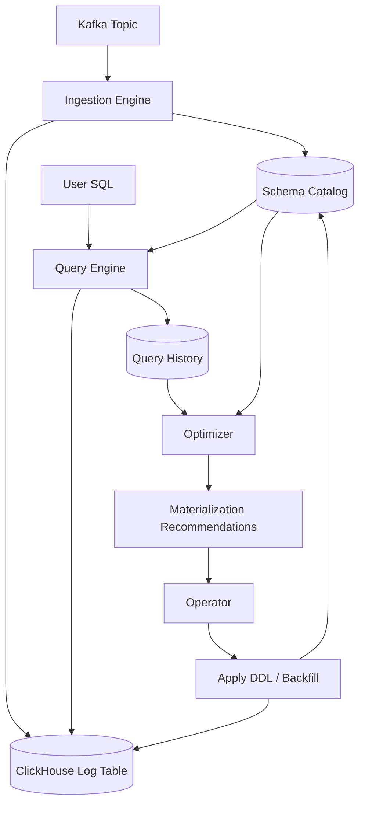

# LogMorph

**Schema-Agnostic Log Ingestion, Query Translation & Adaptive Materialization**

LogMorph is a schema-agnostic log processing engine built on **Apache Kafka** and **ClickHouse**.

It ingests JSON logs without requiring a predefined schema, translates logical queries into ClickHouse-compatible SQL, and analyzes query workloads to recommend materializing frequently accessed fields.

The project is inspired by Uber's schema-agnostic logging architecture.

## 1. Core Principles

- **Schema-on-read:** JSON fields and their runtime types are discovered during ingestion without requiring predefined schemas.
- **Logical–physical separation:** Users query logical field names without knowing how fields are physically stored.
- **Adaptive materialization:** Frequently queried fields can be promoted into dedicated ClickHouse columns.
- **Operator-managed DDL:** LogMorph does not own database schema creation or modification. Operators manage ClickHouse DDL.
- **Modular architecture:** Ingestion, query processing, and optimization are independently deployable capabilities.

## 2. Architecture



The system consists of three execution workflows and a shared metadata layer.

### Ingestion Plane

Responsible for consuming Kafka messages, parsing JSON, classifying runtime types, batching records, and writing data to ClickHouse.

```text
Kafka Consumer
    ↓
JSON Parser / Flattener
    ↓
Runtime Type Classifier
    ↓
Typed Log + Schema Observations
    ↓
Batch Accumulator
    ↓
ClickHouse Writer
```

Responsibilities:

- Kafka consumption and offset management
- JSON parsing and runtime type detection
- Typed log representation
- Batch processing and ClickHouse ingestion
- Schema observation collection
- Retry, backpressure, graceful shutdown, and error handling
- Replay and deduplication strategy

### Query Plane

Responsible for translating logical SQL into physical ClickHouse SQL using schema metadata.

```text
User SQL
    ↓
SQL Parser
    ↓
Logical AST
    ↓
Type / Schema Resolver
    ↓
Physical Expression Planner
    ↓
ClickHouse SQL Generator
```

Example logical query:

```sql
SELECT count()
FROM logs
WHERE service = 'payment';
```

Before materialization:

```sql
SELECT count()
FROM logs
WHERE has(string_names, 'service')
  AND string_values[indexOf(string_names, 'service')] = 'payment';
```

After materialization, if `service` is a dedicated physical column:

```sql
SELECT count()
FROM logs
WHERE service = 'payment';
```

The query engine must handle missing fields, null values, multiple observed types, and explicit casting semantics.

### Optimization Plane

Responsible for analyzing query workloads and recommending schema promotion.

```text
Query History
    ↓
Query Analyzer
    ↓
Field Usage Statistics
    ↓
Materialization Policy
    ↓
Promotion Recommendation
    ↓
Operator-managed DDL
```

Optimization signals include:

- Field access frequency
- Filter and aggregation usage
- Query execution cost
- Rows and bytes scanned
- Estimated performance improvement
- Storage and materialization overhead

In the initial version, the optimizer generates recommendations rather than executing DDL automatically.

### Schema Catalog

The Schema Catalog is the shared metadata layer connecting ingestion, query processing, and optimization.

It maintains:

- Logical field names
- Observed runtime types
- Physical storage mappings
- First-seen and last-seen timestamps
- Materialization status
- Dedicated column mappings
- Metadata versions

Example:

```text
Field: user_id
Observed types: STRING, NUMBER
Materialized: false

Field: service
Observed types: STRING
Materialized: true
Physical column: service
Status: ACTIVE
```

Schema observations and physical schema mappings are separate concepts. Discovering a new runtime type does not automatically require a ClickHouse DDL change.

## 3. Project Structure

LogMorph is organized as a Java 17 Maven multi-module project.

```text
log-morph/
├── pom.xml
├── logmorph-model/
├── logmorph-ingestion/
├── logmorph-catalog/
├── logmorph-query/
└── logmorph-optimizer/
```

| Module | Responsibility |
|---|---|
| `logmorph-model` | Shared domain models and contracts |
| `logmorph-ingestion` | Kafka consumption, JSON transformation, batching, ClickHouse ingestion |
| `logmorph-catalog` | Observed schemas, metadata persistence, physical mappings |
| `logmorph-query` | Logical SQL parsing, schema resolution, SQL generation |
| `logmorph-optimizer` | Query workload analysis and materialization recommendations |

These are library modules, not independent microservices.

### Dependency Rules

- `logmorph-model` has no Kafka, Jackson, or ClickHouse dependencies.
- `logmorph-ingestion` uses shared models and catalog contracts.
- `logmorph-query` uses schema metadata but does not depend on ingestion runtime.
- `logmorph-optimizer` analyzes query metrics and catalog metadata.
- Runtime services share contracts through the model and catalog modules.

## 4. Deployment Model

The core modules will eventually be packaged into three independently deployable applications.

| Application | Runtime | Scaling |
|---|---|---|
| `logmorph-ingester` | Long-running Kafka consumer | Kafka partitions and ingestion throughput |
| `logmorph-query-server` | HTTP query API | Concurrent queries |
| `logmorph-optimizer-worker` | Scheduled/background worker | Analysis workload |

The Schema Catalog does not initially require a separate service. A shared repository implementation backed by persistent metadata storage is sufficient.

## 5. Configuration & Storage Contract

LogMorph requires a Kafka topic and ClickHouse connection, along with table and column mappings.

Example configuration:

```yaml
source:
  bootstrap_servers: kafka:9092
  topic: application-logs
  consumer_group: logmorph-ingester

clickhouse:
  jdbc_url: jdbc:clickhouse://clickhouse:8123/logging
  username: default
  password: ${CLICKHOUSE_PASSWORD}

storage:
  log_table: logs
  schema_table: schema_observations
  query_history_table: query_history

ingestion:
  batch_size: 5000
  flush_interval_ms: 500

materialization:
  mode: recommend
```

Operators are responsible for provisioning ClickHouse tables.

LogMorph validates the configured storage contract at startup, including required columns, data types, and mappings.

The initial typed representation uses:

```text
string_names     Array(String)
string_values    Array(String)

number_names     Array(String)
number_values    Array(Float64)

boolean_names    Array(String)
boolean_values   Array(Bool)

raw_source       String
```

This is the initial storage model and may evolve as the production contract is finalized.

## 6. Execution Workflows

**Ingestion**

1. Consume messages from Kafka.
2. Parse JSON and detect runtime types.
3. Transform records into typed representations.
4. Accumulate records and schema observations.
5. Write batches to ClickHouse.
6. Persist or publish schema metadata.
7. Commit Kafka offsets according to the durability contract.

**Query**

1. Receive a logical SQL query.
2. Parse it into a logical AST.
3. Resolve fields and types through the Schema Catalog.
4. Generate physical ClickHouse SQL.
5. Execute the query and return results.
6. Record query metrics for optimization.

**Materialization**

1. Collect query execution statistics.
2. Identify frequently accessed or expensive fields.
3. Evaluate materialization benefits and costs.
4. Generate promotion recommendations.
5. Let the operator apply DDL and perform any required backfill.
6. Verify the physical column and activate its catalog mapping.
7. Allow the Query Engine to use the promoted column.

## 7. Production Requirements

The production implementation must address:

| Area | Requirements |
|---|---|
| Ingestion reliability | Offset management, retries, replay, deduplication |
| Flow control | Bounded memory, batching, backpressure |
| Error handling | Invalid JSON, unsupported types, DLQ |
| Schema evolution | New fields, type conflicts, nested structures |
| Metadata consistency | Durable observations, versioned mappings |
| Query correctness | Null semantics, missing fields, type coercion |
| Materialization | Recommendation, backfill, verification, activation |
| Observability | Throughput, consumer lag, batch latency, query metrics |
| Operations | Configuration validation, health checks, graceful shutdown |

## 8. Implementation Roadmap

### Phase 1 — Foundation

- Shared domain models
- Storage contract
- Configuration and validation

### Phase 2 — Ingestion

- JSON parser and runtime type classification
- Typed log transformation
- Batch processing
- ClickHouse writer
- Kafka consumer integration
- Reliability and recovery handling

### Phase 3 — Schema Catalog

- Schema observation persistence
- Logical-to-physical field mapping
- Metadata versioning
- Materialization state tracking

### Phase 4 — Query Engine

- SQL parser and logical AST
- Type-aware schema resolution
- Physical SQL generation
- Query execution and metrics collection

### Phase 5 — Optimizer

- Query workload analysis
- Hot field detection
- Materialization cost evaluation
- Promotion recommendations
- Operator-managed materialization lifecycle

## 9. Scope

**In scope**

- Schema-agnostic Kafka ingestion
- Typed ClickHouse storage
- Schema metadata management
- Logical-to-physical query translation
- Query workload analysis
- Adaptive materialization recommendations

**Out of scope**

- Logging UI and dashboards
- Alerting systems
- Authentication and tenant management
- General-purpose ETL orchestration
- Automatic DDL management in the initial release

## 10. Development Approach

- Java 17
- Maven multi-module
- Implement first, then test
- Unit tests for domain and transformation logic
- Integration tests for Kafka and ClickHouse
- Build core libraries before introducing independently deployable services

The initial development priority is to finalize the **domain model and storage contract**, followed by the ingestion engine.